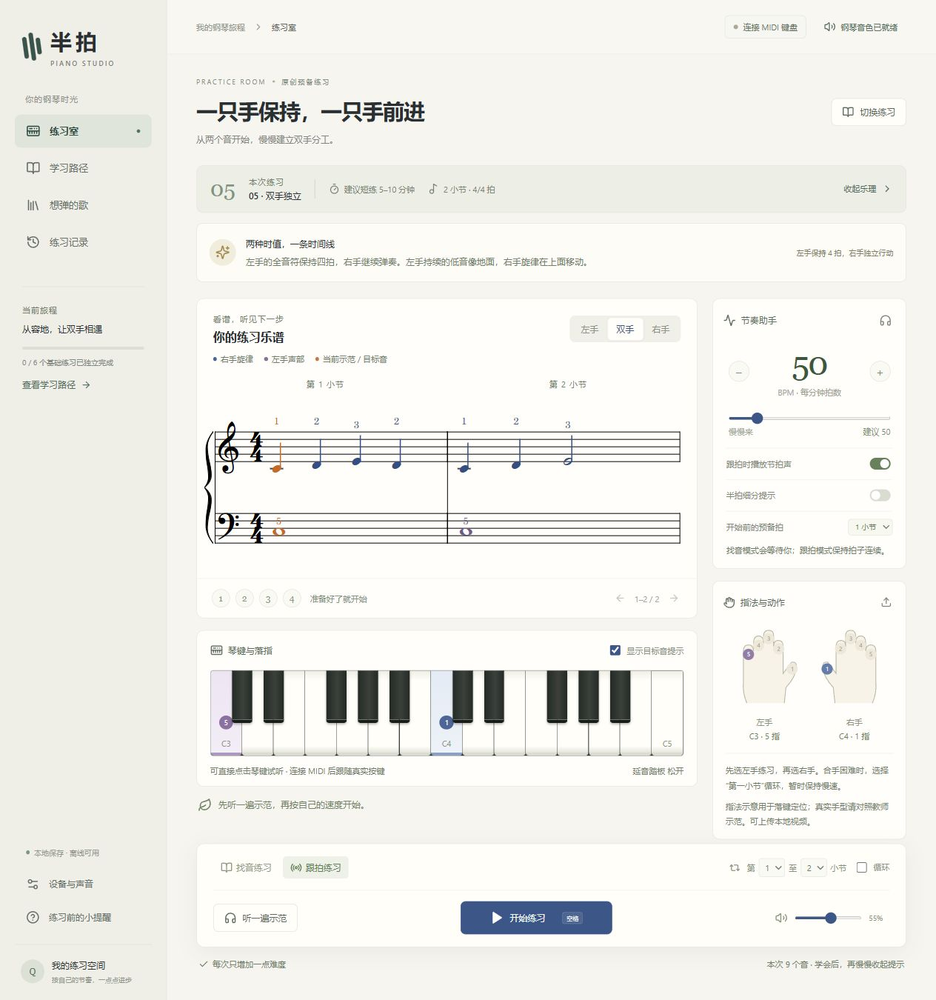

# 半拍 · Piano Studio

一个面向个人学习的 Windows 钢琴练习应用。适合认识琴键、双手配合接近零基础，希望逐步学习识谱、节奏和流行钢琴独奏的人。

## 运行

本仓库提供应用源码。Windows 需要 Microsoft Edge WebView2 Runtime。启动应用后，进入右上角“连接 MIDI 键盘”，刷新并选择 MIDIPLUS 设备，点击“播放测试音”试听。

没有连接键盘时，也可以点击屏幕琴键试听和体验找音练习。屏幕单次点击不能代替需要同时落键的双手练习。

开发环境：Node.js 22、项目指定的 Rust 1.90、Visual Studio C++ 工具链、WebView2。

```powershell
git clone https://github.com/MorseWayne/banpai-piano-studio.git
cd banpai-piano-studio
npm ci
npm run desktop
```

浏览器预览：`npm run dev`，打开 `http://127.0.0.1:1420`。原生桌面通过 `midir` 接收 MIDI；浏览器预览使用 Web MIDI，需要浏览器支持并允许访问。

```powershell
npm test
npm run test:ui
npm run build
npm run desktop:build
```

桌面编译产物：`src-tauri/target/release/banpai.exe`，可双击运行。音色、字体与界面资源嵌入应用，不依赖开发服务器。`release/` 用于保存本机便携版打包输出，构建产物不提交到 Git。

## 当前可用

练习室在谱面上方提供开始、示范、找音/跟拍和声部选择。点击 BPM 调整速度与节拍，点击小节范围设置片段与循环。“练习指导”可展开本课乐理、指法和本地示范视频。

- 学习路径分为五个阶段。每课都可打开讲解、试听谱面和进入练习室。初学者从坐姿课开始，有基础的学习者可以直接选择阶段。
- 交互式钢琴大谱表支持缩放、选小节和跟弹光标。点击谱上的音符或和弦即可试听，打开目标音提示时，琴键同时标出落指位置。试听不会计入练习记录。
- 找音模式：等待正确音符，同一拍的多个音需要同时保持；长按不会重复计分。
- 跟拍模式：预备拍后持续前进；音高、错音、提前/滞后、松键时值偏差分别记录。分手练习时可由应用演奏另一声部。
- 可调速节拍器、重拍、半拍细分、预备拍、选小节循环、独立听拍。
- 本地钢琴采样、力度响应、延音踏板、停止全部声音、MIDI 断开暂停。
- MusicXML 本地导入、练习记录保存与 JSON 导出、上次课程恢复。
- 本地手部视频播放、慢放；视频只在本次应用会话内保留，不上传。
- 3D 指法提供演奏视角和俯视键位，随目标音和实际按键显示指法与落键。可开启“拇指特写”，在完整键位旁同步显示拇指侧的低位观察画面，支持切换左右手、8°–40°观察高度、1.25 倍局部放大与镜头复位。控件位于画面上下，特写跟随拇指关节移动。桌面练习区按窗口高度分配谱面与演示空间。

3D 手部采用 Ultraleap 官方 GenericHand 模型与原生骨骼绑定，模型以 Apache 2.0 许可分发，完整许可与转换说明见 `public/hands/ULTRALEAP-LICENSE.txt` 和 `public/hands/ULTRALEAP-NOTICE.txt`。界面使用柔和的中性材质，通过左手紫色、右手蓝色标出当前示范手指。Three.js 官方 CCDIKSolver 在关节角度约束内求解落键动作，保留骨骼层级与骨段长度。灯光复用 RoomEnvironment 与 PMREMGenerator。模型和灯光均支持离线运行。[Ultraleap 手模](https://github.com/ultraleap/UnityPlugin/tree/develop/Packages/Tracking/Hands/Runtime/Models/GenericHand) · [Three.js CCDIKSolver](https://threejs.org/docs/pages/CCDIKSolver.html)

需要重新转换模型时，下载 NOTICE 中记录的 GenericHand.fbx，运行 `node scripts/convert-ultraleap-hand.mjs <FBX路径>`，即可生成项目使用的左右手 GLB。

指法驱动按左右手、音高与 1–5 指编号工作，支持同音换指、连续换音、已按手指保持和下一指预备。移动使用抬指弧线，空闲手指与模型原有放松姿态混合。导入的 MusicXML 可直接携带指法，无指法的音仅显示键位。MIDI 提供音高和触键事件，实际使用哪根手指需要自行对照示范。穿指、跨指等精确教学动作仍需教师校准。

找音模式不评价节奏。“独立完成”只统计整课、无目标音提示、无错音的完成记录；这不是对手型或完整演奏能力的认证。

## 怎样沿着路线练

| 阶段 | 键盘上的主要任务 | 离开提示后的阶段作品 |
| --- | --- | --- |
| 入门触键 | 键盘定位、两手指法、读大谱表、数拍与合手 | 连续弹两遍双手短句，低音换键时旋律保持连贯 |
| 读谱与键盘熟练度 | 音程、C/G 大调音阶、大小调主和弦琶音、八分细分和三拍子视奏 | 分手上下行一个八度，预读并一次弹完一条陌生四小节旋律 |
| 和弦与移调 | 大小三和弦、终止、就近转位、斜线低音、级数与移调 | 在 C 与 G 两调只看和弦符号伴奏，听换和弦处是否丢拍 |
| 流行伴奏与即兴 | 分解、二四拍重音、切分、挂留与附加音、七和弦、副属和弦与即兴答句 | 给同一段旋律配两种织体，在句尾留白处加入回应 |
| 独立编配与演出 | 听写、主副歌布局、旋律置顶、前奏尾声、断点重入与录音复盘 | 为一首自选曲交付结构和弦谱、移调方案及完整演奏录音，再把方法用在另一首歌上 |

初学阶段借鉴 Alfred 将乐理与技巧配对的教学方式，后续基础课参考 ABRSM 的视奏、听力、音阶与作品训练。和声与流行阶段参考 Berklee 的和弦谱、声部连接、伴奏和即兴课程。应用内谱例均为原创。[Alfred 成人综合教程](https://www.alfred.com/products/alfred-s-basic-adult-all-in-one-course-book-1-00-37748) · [ABRSM Practical Grades](https://www.abrsm.org/en-gb/about-practical-grades) · [Berklee Keyboard Method](https://online.berklee.edu/courses/berklee-keyboard-method) · [Pop/Rock Keyboard](https://online.berklee.edu/courses/pop-rock-keyboard)

可从一次 25 分钟的练习开始。用 5 分钟唱音、数拍或复习音阶，10 分钟慢练当课最容易停住的小节，最后 10 分钟做离谱任务或处理自选曲。隔天先试弹上次的难点。进入流行阶段后，逐渐把更多时间给整段伴奏、听写和录音复听。应用记录谱内音符的完成情况，阶段作品由学习者或老师结合录音评估。

## 三首目标曲目

《枫》《蒲公英的约定》（周杰伦）与《唯一》（邓紫棋演唱版）作为目标曲目保留。**当前没有内置这些歌曲的真实谱例、原曲录音或教师手部视频。** 课程中的原创练习没有被标成这些歌曲。

可在“想弹的歌”导入有权使用的简化 MusicXML 乐谱。`public/example.musicxml` 是可用于验证导入的原创双手谱例。下一步内容工作是确定具体片段与分级编配、审核指法并配置教师示范。

## 导入支持范围

- 未压缩 `.musicxml` / `.xml`，最大 2 MB、512 个音、32 个四拍小节范围。
- `score-partwise`，一份钢琴大谱表或两个独立声部，固定 3/4 或 4/4 拍。
- 支持音高、升降音、休止、同起同时值的和弦、常规与附点时值、1–5 指法。
- 暂不支持压缩 `.mxl`、反复、连音线、连音组、装饰音、同手多声部交叠、变拍号和跨小节长音。遇到这些输入会说明原因，不会静默转换成错误乐谱。
- 谱面根据课程音符重新排版，保留导入音符的升降拼写、时值、分手和指法。原文件的版式、调号和表情标记不保存。建议导入完整小节的短练习片段。

## 数据和音频

练习记录、导入乐谱和上次课程保存于本机 WebView 的 localStorage，最多保存 200 条练习记录。不需要账号，不向服务器上传演奏数据。

节拍器和示范使用 Web Audio 时间轴。提供手动输入时间补偿，设备报告的延迟不等于完整实测延迟，不能替代真实设备校准。硬件延迟、键盘力度曲线和踏板表现需要在使用的 MIDIPLUS 键盘上测试。

MIDI 只提供音符、力度及控制消息。应用不能识别实际使用了哪根手指，也不能判断姿势是否正确。手部图是建议指法的位置示意，教师视频目前手动播放，尚未与谱面自动同步。

钢琴采样：Alexander Holm 的 Salamander Grand Piano，MP3 来源为 Tone.js 音频分发；原作者已声明公共领域，并保留历史 CC BY 3.0 署名。详见 `public/samples/CREDITS.txt`。音色采用九个采样的最近音高重采样，不是多力度层专业音源。

## 已完成的验证

- TypeScript、Vite 生产构建和 Windows 原生编译通过。
- 单元测试覆盖课程顺序与可达性、谱例时值和指法、进度迁移、MIDI 评分与手部骨骼。
- `npm run test:ui` 使用 Playwright 和本机 Microsoft Edge，覆盖跨阶段学习、整课练习范围、进度保存、窄屏翻谱、MusicXML 导入、MIDI 输入与 3D 指法。
- 界面操作验证：八个单音完成记录、课程切换、双手 MusicXML 导入、示范预备拍和速度设置。
- Windows 应用已启动，内置音色加载成功；设备列表正常打开，但验证时没有连接 MIDI 键盘。
- 尚未完成：真实 MIDIPLUS 硬件与端到端延迟测试、教师审核课程与手型视频。



## 代码结构

- `src/model.ts`：MIDI 消息归一化、分组与评分。
- `src/PracticeRoom.tsx`、`src/PracticeControls.tsx`：练习室布局、播放控制与 Radix UI 交互组件。
- `src/useStudio.ts`：练习状态、计时、MIDI 连接与记录。
- `src/audio.ts`：钢琴音源、音量、踏板、节拍器。
- `src/Score.tsx`、`src/scoreMusicXml.ts`：将课程音符交给 OpenSheetMusicDisplay 排版，并同步谱面试听、指法与跟弹光标。
- `src/components.tsx`：指法示意和本地示范视频。
- `src/Keyboard.tsx`：基于 audio/ui Piano 的屏幕琴键，随可用宽度调整显示音域，并叠加课程指法和 MIDI 按键状态。
- `src/HandKeyboard.tsx`、`src/pianoScene.ts`、`src/pianoHandRig.ts`、`src/pianoHand.ts` 与 `src/fingeringPose.ts` 负责 3D 视图、模型骨骼适配、手指过渡和课程指法驱动。
- `src/import.ts`：MusicXML 导入与支持范围校验。
- `src/lessons.ts`：渐进练习与简短乐理。
- `src-tauri/src/main.rs`：Windows 原生 MIDI 桥接与桌面窗口。

## 后续重点

1. 在具体 MIDIPLUS 型号上验证 MIDI、力度、踏板和发声延迟。
2. 三首目标曲的真实、经审核的分级片段与教师视频。
3. 视频与谱面定位同步、更多乐谱记号、节奏训练中的语音数拍。
4. 结合实际练习反馈调整容差、课程难度和下一步建议。
